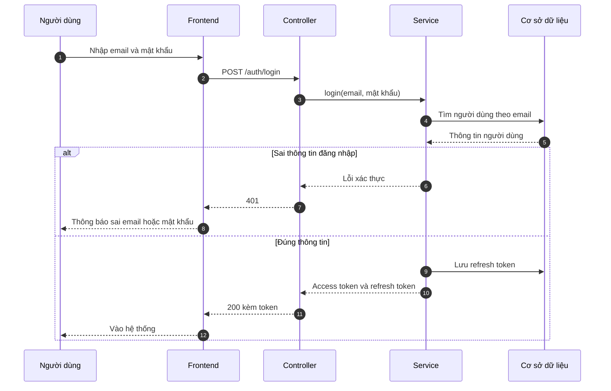

# README: Hệ thống quản lý dự án và công việc cho doanh nghiệp

Tài liệu này dành cho **một agent (AI)** tiếp nhận công việc. Đọc hết file này để hiểu dự án, quy ước, và biết chính xác việc cần làm: **thiết kế và vẽ Activity Diagram và Sequence Diagram** bằng **Mermaid**.

---

## 1. Bối cảnh

- **Loại sản phẩm:** Tiểu luận chuyên ngành (Khoa Công nghệ thông tin, Trường ĐH Công nghệ Kỹ thuật TP.HCM), nhóm 2 sinh viên.
- **Tên đề tài:** Phân tích, thiết kế và xây dựng hệ thống quản lý dự án và công việc cho doanh nghiệp.
- **Ngôn ngữ tài liệu:** tiếng Việt. Mọi nhãn trong sơ đồ viết bằng tiếng Việt (tên kỹ thuật như API, token, WebSocket giữ nguyên).
- **Mục tiêu hệ thống:** một nền tảng SaaS cho phép doanh nghiệp vừa và nhỏ quản lý công việc theo **Scrum, Kanban và Scrumban** trên cùng một nền tảng, đủ mạnh cho doanh nghiệp nhưng dễ dùng cho người mới (nguyên tắc **Progressive Disclosure**).
- **Điểm khác biệt so với Jira, Trello, Monday:** hỗ trợ Scrumban nguyên bản, Control Board (màn hình trung tâm vừa lập kế hoạch Sprint, vừa làm việc với Task, vừa cấu hình), AI trích xuất Task/Project từ tài liệu, chuyển đổi phương pháp mà không mất dữ liệu, mẫu dự án có thể công khai.

---

## 2. Công nghệ và kiến trúc

**Kiến trúc:** Client-Server, Backend theo **Modular Monolith** kết hợp **Layered** (Controller, Service, Repository).

| Tầng | Công nghệ |
|---|---|
| Frontend | ReactJS (CSR), TailwindCSS, Shadcn UI, Zustand, TanStack Query, thư viện kéo thả |
| Backend | NestJS (TypeScript), REST API, WebSocket cho realtime |
| Dữ liệu | PostgreSQL, ORM (Prisma), Redis (cache, tùy chọn) |
| Lưu tệp | Dịch vụ lưu trữ ngoài (Cloudinary hoặc S3) |
| Dịch vụ ngoài | Google Gemini API (AI), Google OAuth, dịch vụ gửi email, cổng thanh toán |

> Một số lựa chọn chưa chốt (ReactJS hay Next.js, Prisma hay TypeORM, Cloudinary hay S3, cổng thanh toán nào). **Trong sơ đồ dùng tên trung tính:** "Frontend", "Backend", "Cơ sở dữ liệu", "Kho lưu trữ tệp", "Cổng thanh toán". Không nhắc tên công nghệ chưa chốt.

**Các module Backend (NestJS):** Auth, Workspace, Project, Task (gồm Sprint, Backlog), Config (Work Type, Status, Workflow, Custom Field), Views (Summary, Control Board, Board, Gantt, Calendar), Collaboration (comment, attachment, link, label, notification), AI, Settings, và các module thanh toán/mẫu dự án.

**Thành phần dùng chung:** Guards (kiểm tra JWT và quyền RBAC), Interceptors, DTO/Pipes (kiểm tra dữ liệu), Exception Filters (xử lý lỗi tập trung).

**Luồng chuẩn của một request:** Frontend gửi HTTP kèm JWT → Controller → Guard (xác thực, kiểm tra quyền) → Service (nghiệp vụ) → ORM → Database → trả response; Frontend cập nhật state và giao diện. Các thay đổi cần cho người khác thấy ngay được đẩy qua WebSocket.

---

## 3. Xác thực và phân quyền

- **JWT:** access token (ngắn hạn) + refresh token (dài hạn). Refresh token được lưu ở bảng `refresh_tokens` và thu hồi bằng `revoked_at` khi đăng xuất. Access token hết hạn thì Frontend tự xin cấp lại bằng refresh token.
- **Đăng nhập:** email/mật khẩu hoặc Google. Tài khoản phải xác thực email (mã có thời hạn) trước khi đăng nhập.
- **RBAC hai cấp** (giả định, có thể điều chỉnh):
  - Cấp Workspace: Owner, Admin, Member, Viewer.
  - Cấp Project: Owner, Member, Viewer.
- Mọi API đều được Guard kiểm tra quyền ở Backend. Kiểm tra ở giao diện chỉ để hỗ trợ trải nghiệm.
- Luật bảo vệ khi phân vai trò: không gán vai trò cao hơn vai trò của chính mình; không hạ vai trò của Owner cuối cùng.

---

## 4. Danh sách chức năng (theo phân hệ)

| Mã | Phân hệ | Chức năng chính |
|---|---|---|
| QLTK | Tài khoản và xác thực | Đăng ký, xác thực email, đăng nhập, đăng nhập Google, quên và đặt lại mật khẩu, đăng xuất, hồ sơ cá nhân, đổi mật khẩu |
| QLWS | Workspace | Tạo Workspace, cập nhật, quản lý thành viên, phân vai trò, xem danh sách Project |
| QLDA | Project | Tạo Project (chọn phương pháp và mẫu), cấu hình, quản lý thành viên, chuyển quyền sở hữu, xóa |
| QLT | Task và Sprint | Tạo, sửa, xóa Task; kéo thả đổi trạng thái; gán Task vào Sprint; lọc, sắp xếp, nhóm; tạo, bắt đầu, hoàn thành Sprint; Backlog |
| QLV | View | Tổng quan, Board, Gantt, Calendar, Control Board, tìm kiếm và lọc |
| QLC | Cộng tác | Bình luận, tệp đính kèm, liên kết ngoài, nhãn, thông báo |
| QLCF | Cấu hình Project | Work Type, Status, Workflow, Transition, Custom Field, WIP Limit, gán Workflow cho Work Type |
| AIDOC | AI | Upload tài liệu, phân tích bằng AI, xem và chỉnh Task/Project đề xuất, xác nhận tạo, lịch sử phân tích |
| QLQ | Thiết lập và phân quyền | Thiết lập Workspace/Project/User, cấu hình quyền, xóa Workspace/Project |
| Mẫu | Mẫu dự án | Lưu cấu hình Project thành mẫu, đặt Riêng tư hoặc Công khai, dùng mẫu khi tạo Project |
| Thanh toán | Gói cước | Tạo giao dịch thanh toán, xử lý kết quả thanh toán và kích hoạt gói cho Workspace |

**Phương pháp quản lý:**
- **Scrum:** Backlog, Sprint (một Sprint đang chạy mỗi Project), Board.
- **Kanban:** Board, WIP Limit, Workflow.
- **Scrumban:** kết hợp Backlog, Sprint (tùy chọn) và WIP Limit.
- Mỗi Project chọn một phương pháp (cột `projects.methodology`) và có thể chuyển đổi mà không mất dữ liệu. Backlog = Task có `sprint_id` rỗng. WIP Limit chỉ áp dụng cho Kanban và Scrumban.

---

## 5. Mô hình dữ liệu (tóm tắt)

Các bảng chính (khóa chính `id` dạng UUID):

- **Tài khoản:** `users`, `verification_codes`, `refresh_tokens`
- **Phân quyền:** `roles` (có `scope`: WORKSPACE hoặc PROJECT), `permissions`, `role_permissions`
- **Tổ chức:** `workspaces`, `workspace_members`, `projects` (có `methodology`), `project_members`
- **Cấu hình Project:** `work_types`, `statuses` (có `wip_limit`), `workflows`, `workflow_transitions`, `custom_fields`, `custom_field_values`
- **Công việc:** `sprints` (status: PLANNED, ACTIVE, COMPLETED), `tasks` (có `sprint_id`, `status_id`, `work_type_id`, `assignee_id`, `parent_id`, `priority`, `due_date`), `labels`, `task_labels`
- **Cộng tác:** `comments`, `attachments`, `task_links`, `notifications`, `activity_logs`
- **AI:** `ai_documents`, `ai_suggested_tasks`

**Cần bổ sung** (chưa có trong ERD): bảng mẫu dự án (có cờ công khai), gói cước (plan), đăng ký gói (subscription) và giao dịch thanh toán (payment/transaction với trạng thái Chờ, Thành công, Thất bại, Hủy). Khi vẽ sơ đồ liên quan, cứ dùng các khái niệm này.

---

## 6. NHIỆM VỤ CỦA BẠN

Thiết kế và viết code Mermaid cho hai nhóm sơ đồ dùng trong **Chương 3 (Thiết kế hệ thống)** của tiểu luận:

1. **Activity Diagram: 18 sơ đồ** (danh sách ở mục 7). Đã có bản nháp đầu tiên; xem lại, chỉnh theo yêu cầu người dùng.
2. **Sequence Diagram: 10 sơ đồ** (danh sách ở mục 8). **Chưa vẽ, đây là việc chính cần làm.**

### Quy trình làm việc
1. Đọc kỹ mục 1 đến 5 để hiểu hệ thống.
2. Làm theo từng lượt **3 đến 4 sơ đồ**, để người dùng kiểm tra rồi mới làm tiếp.
3. Với mỗi sơ đồ, nêu ngắn gọn các **giả định** đã đặt (nếu có) để người dùng sửa.
4. Viết code vào file `.md`, mỗi sơ đồ một khối ```` ```mermaid ````, có tiêu đề rõ.
5. Sau khi người dùng phản hồi, sửa đúng chỗ được góp ý, giữ nguyên phần còn lại.

### Nguyên tắc
- **Không bịa chức năng** ngoài danh sách ở mục 4. Cần thêm gì thì hỏi hoặc ghi rõ là giả định.
- **Mỗi sơ đồ phải có nhánh lỗi thật** (không đủ quyền, dữ liệu sai, không tồn tại, vi phạm luật nghiệp vụ), không chỉ luồng thành công.
- **Nhất quán thuật ngữ** giữa mọi sơ đồ: Workspace, Project, Task, Sprint, Backlog, Work Type, Status, Workflow, WIP Limit, Custom Field, Owner, Admin, Member, Viewer.
- Mỗi sơ đồ chỉ nên có **tối đa khoảng 20 nút** (activity) hoặc **4 đến 7 lifeline** (sequence). Quá dài thì tách hoặc rút gọn.
- Không dùng ký tự gây lỗi Mermaid: trong nhãn activity luôn đặt trong dấu nháy kép; trong sequence tránh dấu chấm phẩy và dấu thăng.

---

## 7. Activity Diagram: danh sách 18 sơ đồ (đã có bản nháp)

| # | Sơ đồ | Điểm cần thể hiện |
|---|---|---|
| 1 | Đăng nhập | Dữ liệu sai, sai thông tin, chưa xác thực email, cấp token |
| 2 | Đăng xuất | Thu hồi refresh token, dọn dữ liệu phía client, vẫn đăng xuất nếu gọi API lỗi |
| 3 | Đăng ký và xác thực tài khoản | Email trùng, mã sai, mã hết hạn gửi lại, kích hoạt |
| 4 | Đăng nhập bằng Google | Người dùng từ chối, tài khoản mới hay đã có, liên kết |
| 5 | Tạo Workspace | Trùng slug, gán Owner, mời thành viên |
| 6 | Quản lý thành viên | Hai phạm vi Workspace và Project, kiểm tra quyền, không xóa Owner duy nhất |
| 7 | Phân vai trò | Kiểm tra quyền, đúng cấp, không vượt quyền, không hạ Owner cuối |
| 8 | Tạo Project, chọn phương pháp và mẫu | Chọn Scrum/Kanban/Scrumban, dùng mẫu hoặc mặc định, bật chức năng theo phương pháp |
| 9 | Tạo Task (gồm cấu hình Task) | Quyền, trường bắt buộc, Work Type, Backlog hay Sprint |
| 10 | Kéo thả Task | Quyền, Workflow hợp lệ, WIP Limit, realtime |
| 11 | Bình luận Task | Quyền, lưu, thông báo realtime |
| 12 | Gán tệp đính kèm | Định dạng, dung lượng, lỗi tải lên |
| 13 | Vòng đời Sprint (gồm gán Task) | Chỉ một Sprint chạy, xử lý Task chưa xong khi hoàn thành |
| 14 | Cấu hình Workflow, Status, WIP Limit | Xóa Status đang có Task, WIP chỉ cho Kanban/Scrumban |
| 15 | AI phân tích tài liệu tạo Project | Trích xuất, lỗi AI, người dùng duyệt trước khi tạo |
| 16 | Lưu cấu hình Project thành mẫu, đặt công khai | Riêng tư hay công khai, không sao chép Task và thành viên |
| 17 | Tạo giao dịch thanh toán | Giao dịch trạng thái Chờ, chuyển sang cổng thanh toán |
| 18 | Xử lý thanh toán và kích hoạt | Kiểm tra chữ ký, chống xử lý trùng, kiểm tra số tiền, kích hoạt gói |

### Quy ước kỹ thuật cho Activity Diagram
- Dùng `flowchart TD` với **swimlane bằng `subgraph`** (làn: Người dùng, Hệ thống, và làn ngoài như Google, AI, Cổng thanh toán nếu có).
- Hình dạng: `([...])` bắt đầu/kết thúc, `["..."]` bước xử lý, `{"..."}` điều kiện. Nhãn luôn trong dấu nháy kép.
- Nhãn mũi tên rẽ nhánh: `-->|"Có"|`, `-->|"Không"|`.
- Khai báo nút trong `subgraph` trước, nối cạnh ở dưới.

---

## 8. Sequence Diagram: danh sách 10 sơ đồ (CẦN VẼ)

Lifeline chuẩn (dùng thống nhất, chỉ lấy những cái cần cho từng sơ đồ): **Người dùng**, **Frontend**, **Controller**, **Guard**, **Service**, **Cơ sở dữ liệu**, và dịch vụ ngoài khi có (Dịch vụ email, Google, Kho lưu trữ tệp, Gemini API, Cổng thanh toán, WebSocket).

| # | Sơ đồ | Lifeline gợi ý | Điểm cần thể hiện |
|---|---|---|---|
| 1 | Đăng nhập và làm mới token | Người dùng, Frontend, Controller, Service, CSDL | Kiểm tra mật khẩu, cấp access và refresh token, `alt` sai thông tin, `loop` hoặc `opt` access token hết hạn thì tự xin cấp lại bằng refresh token, nhánh refresh token hết hạn thì về trang đăng nhập |
| 2 | Đăng ký và xác thực email | Người dùng, Frontend, Controller, Service, CSDL, Dịch vụ email | Kiểm tra trùng email, tạo tài khoản chưa kích hoạt, gửi mã, nhập mã, `alt` mã sai hoặc hết hạn |
| 3 | Tạo Project và chọn phương pháp, mẫu | Người dùng, Frontend, Guard, Service, CSDL | Kiểm tra quyền, sao chép mẫu hoặc tạo cấu hình mặc định (Status, Workflow, Work Type), bật chức năng theo phương pháp |
| 4 | Tạo Task (đại diện cho sửa, xóa) | Người dùng, Frontend, Guard, Service, CSDL | Quyền, kiểm tra dữ liệu, lưu, ghi nhật ký, tạo thông báo |
| 5 | Kéo thả Task trên Board | Người dùng, Frontend, Guard, Service, CSDL, WebSocket | Quyền, kiểm tra Workflow và Transition, kiểm tra WIP Limit (`alt`), cập nhật, đẩy realtime cho người khác, hoàn tác giao diện khi lỗi |
| 6 | Thêm thành viên và phân vai trò (RBAC) | Người dùng, Frontend, Guard, Service, CSDL | Guard kiểm tra quyền theo vai trò, luật bảo vệ Owner, cập nhật vai trò, thông báo |
| 7 | Bình luận và thông báo realtime | Người dùng, Frontend, Guard, Service, CSDL, WebSocket | Lưu bình luận, tạo thông báo, đẩy tới người liên quan đang online |
| 8 | AI Document Analyzer | Người dùng, Frontend, Service, Kho lưu trữ, CSDL, Gemini API | Upload, trích xuất văn bản, gọi Gemini, kiểm tra JSON, trả đề xuất, người dùng duyệt, tạo hàng loạt, `alt` AI lỗi, xử lý bất đồng bộ (polling hoặc thông báo khi xong) |
| 9 | Tạo giao dịch thanh toán | Người dùng, Frontend, Service, CSDL, Cổng thanh toán | Tạo giao dịch trạng thái Chờ, tạo yêu cầu thanh toán, chuyển hướng người dùng sang cổng |
| 10 | Xử lý kết quả thanh toán và kích hoạt gói | Cổng thanh toán, Controller, Service, CSDL, Dịch vụ email | Nhận callback, kiểm tra chữ ký, tránh xử lý trùng, đối chiếu số tiền, `alt` thành công hoặc thất bại, kích hoạt gói, gửi email xác nhận |

### Quy ước kỹ thuật cho Sequence Diagram
- Dùng `sequenceDiagram` với `autonumber`.
- Khai báo `participant X as Tên tiếng Việt`.
- Thông điệp gọi dùng `->>`, trả về dùng `-->>`. Dùng `alt ... else ... end`, `opt ... end`, `loop ... end` cho rẽ nhánh.
- **Đặt tên thông điệp theo API đề xuất**, ví dụ `POST /auth/login`, `PATCH /tasks/:id/status`, `POST /projects`. Các endpoint này là **đề xuất** vì phần thiết kế API chưa chốt; ghi chú điều đó ở đầu mỗi lượt.
- Dùng `activate`/`deactivate` hoặc `+`/`-` khi cần thể hiện thời gian xử lý, nhưng không bắt buộc.
- Mỗi sơ đồ nên kèm **mô tả ngắn 3 đến 5 câu** để người dùng chép vào tiểu luận.

**Ví dụ khung (rút gọn) cho sơ đồ 1:**



---

## 9. Định dạng đầu ra

- Một hoặc nhiều file `.md`, mỗi sơ đồ một khối ```` ```mermaid ```` có tiêu đề cấp 2 đánh số.
- Đầu file ghi hướng dẫn dán vào draw.io: **Arrange → Insert → Advanced → Mermaid**, dán code (không kèm dòng ```` ``` ````), bấm Insert, mỗi lần một sơ đồ.
- Đầu file liệt kê rõ **các giả định** đã đặt.
- Khi hoàn tất mỗi lượt, tóm tắt ngắn: đã vẽ những sơ đồ nào, giả định nào cần người dùng xác nhận, lượt tiếp theo sẽ vẽ gì.

---

## 10. Các điểm còn mở (hỏi người dùng khi cần)

- Vai trò chính xác của Workspace và Project.
- Có dùng Redis để thu hồi token và cache quyền không; thời hạn token.
- Cổng thanh toán cụ thể, các gói cước, có gói miễn phí không.
- Mẫu công khai có cần duyệt không; ai được xem và dùng.
- AI tạo cả Project (phương pháp, Task) hay chỉ tạo Task; xử lý bất đồng bộ bằng polling hay WebSocket.
- WIP Limit có áp dụng cho Scrum không (hiện giả định: chỉ Kanban và Scrumban).
- Có dùng WebSocket cho tất cả tính năng realtime hay chỉ một số.

Nếu thông tin nào chưa chắc, **đặt giả định hợp lý, ghi rõ, và để người dùng sửa**, đừng dừng lại hỏi quá nhiều.
